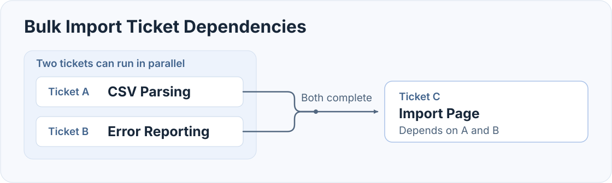
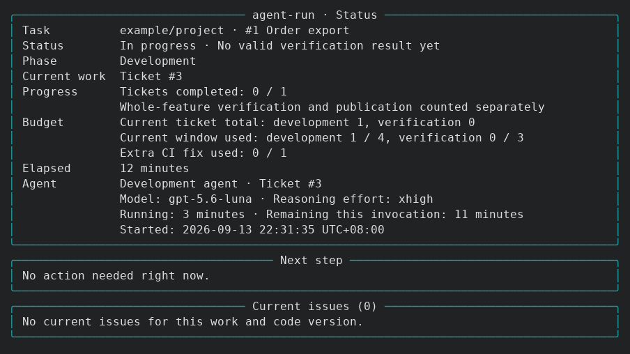
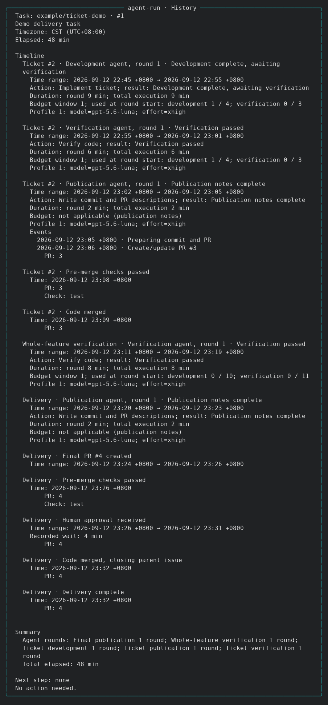
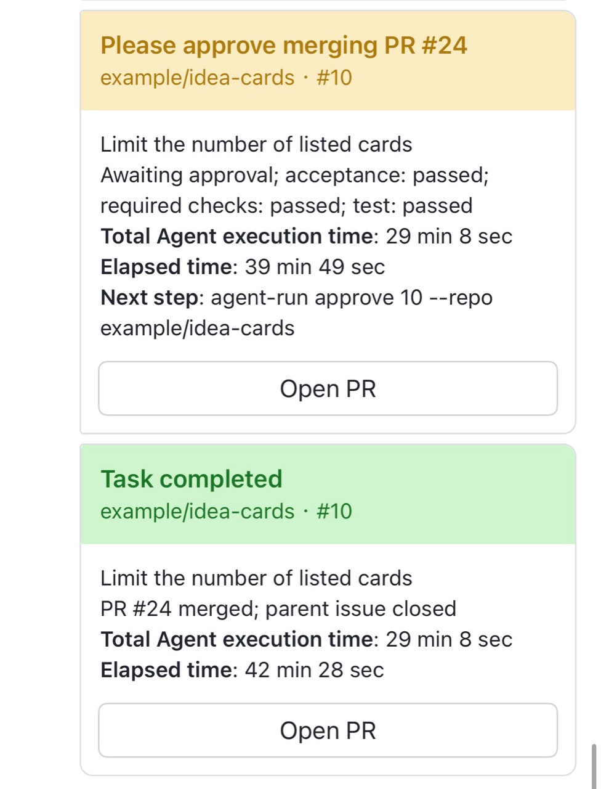
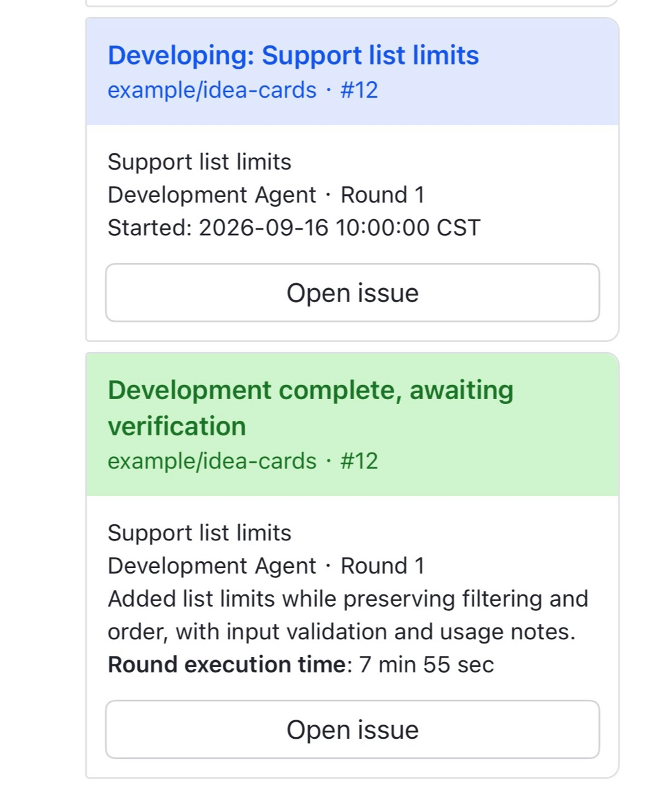
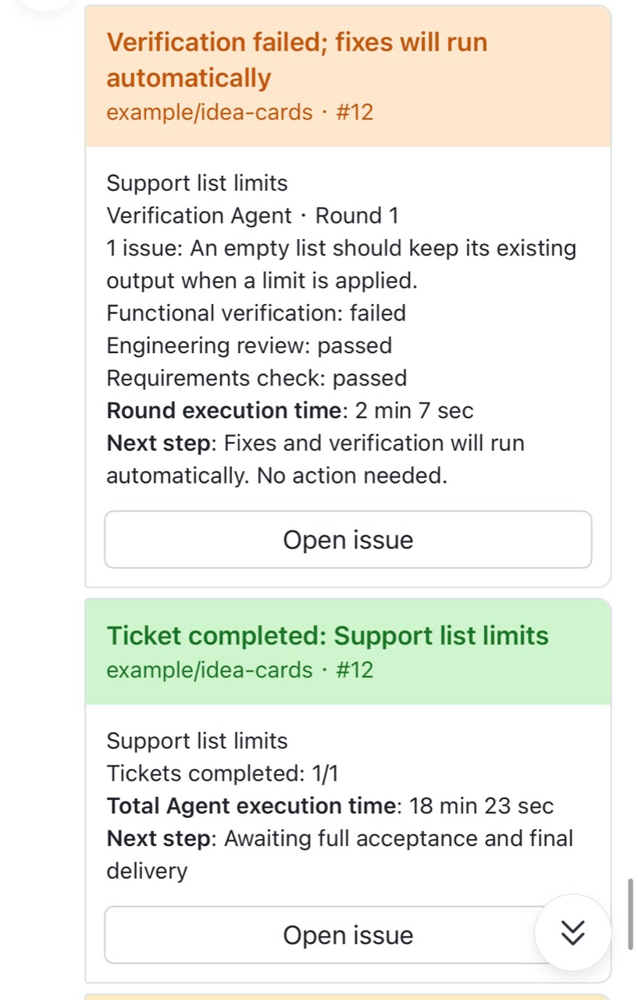
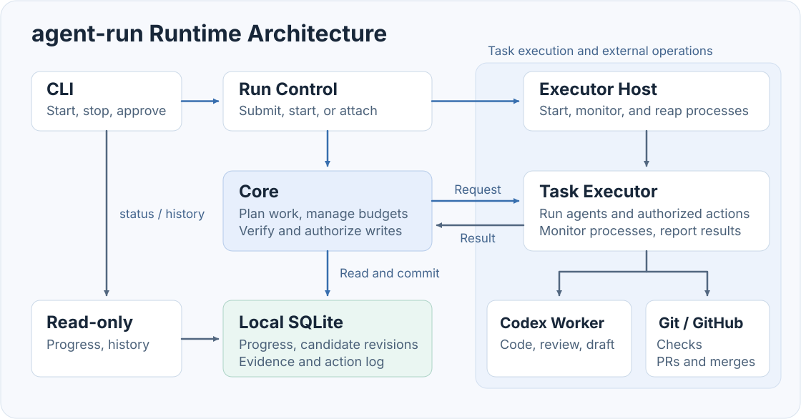

# grill-engineering

English | [简体中文](README.zh-CN.md)

**Turn a GitHub task into a PR you can review and approve with one command.**

Use `grill-me` or `grill-with-docs` to work through the requirements, then use `to-spec` and `to-tickets` to put the agreed spec and tickets on GitHub. [Matt Pocock Skills](https://github.com/mattpocock/skills)

`agent-run` takes a prepared GitHub issue and coordinates Codex development and independent review. Tickets run in parallel as their dependencies allow. Once they are integrated, another agent verifies the whole feature against the original requirements. The runner follows the required checks, and you approve the final merge into the default branch.

[Get started](#get-started) · [Delivery workflow](#delivery-workflow) · [Screenshots](#screenshots) · [Feishu notifications](#feishu-notifications) · [Current architecture](#current-architecture)

## Get started

Follow the [Agent guide](docs/agent-guide.en.md) to install `agent-run`, authenticate, and connect the target repository. Once your parent issue is ready, run the command from any directory. This example uses issue `123`.

```bash
agent-run run 123 --repo OWNER/REPO
```

The runner works in a separate clone of the remote repository, starting from pushed code. You can keep working in your own checkout and inspect or control the same run from another directory.

<details>
<summary>Ask your agent to install and start a run</summary>

```text
Read https://github.com/GRD-Chang/grill-engineering/blob/main/docs/agent-guide.en.md.
Install agent-run, check that the repository and GitHub task are ready, and start the run.
Repository path: <local path>
Parent issue: <GitHub issue URL>
Let me know when you need input or approval for the final PR.
```

</details>

The runtime uses Linux, Codex CLI, and GitHub. Foreground execution, WSL2 on Windows, and Linux virtual machines on macOS still await validation. See the [support matrix](docs/productization/support.md). Runs use your Codex account quota. You can set models for each role, repair limits, and wait times in [user settings](docs/user-defaults.md).

## Delivery workflow

### Example ticket dependencies

Suppose you want to add bulk import to a contacts app. A user uploads a CSV to add several contacts at once. If the file contains an error, the page should say which row has a problem and what went wrong.

You can split the work into the three tickets below. CSV parsing reads the rows, while error reporting turns problems into clear messages. These two tickets can run in parallel. Once both are complete, the import page can connect them to the upload flow.



### From ready tickets to final merge

`agent-run` reads issues and dependencies from GitHub and schedules development and independent review locally. Ready tickets can proceed in parallel. Each ticket is integrated locally and checked on GitHub before it merges into the run's integration branch, called the Run Branch.

![Blue nodes are local runner and agent operations. Purple nodes are GitHub operations. Tickets go through development and independent review, then queue for integration. Local integration failures return to a development agent for repair. Ticket PR CI failures return to the agent for that ticket, as shown with Ticket A. Full acceptance findings or final PR CI failures trigger run-level repair. An independent reviewer verifies the fix before the repair PR is checked and merged into the Run Branch. The maintainer approves the final PR after its checks pass.](docs/images/delivery-workflow.en.svg)

Review agents check requirements, code standards, and end-to-end behavior from read-only workspaces. In the contacts example, once all three tickets are merged into the Run Branch, a separate agent tests the import page with two CSVs. It uploads a valid file and checks that the contacts are added. It then uploads a file with a missing name on row 3 and checks that the page says “Row 3 is missing a name.”

Other tickets can continue through development and review while CI runs. When a required check fails on a ticket PR, that ticket's development agent uses the check results and any available logs to fix it. The fix goes through review if configured, then the ticket queues for integration again and the new commit is checked. Run-level fixes always require independent acceptance. [Ticket CI repair](docs/adr/0021-ticket-ci-development-loop.md) · [Run repair PRs](docs/adr/0031-parent-repair-pr-and-repository-ci.md)

If the requirements fit in a single issue, run it directly. It goes through development, independent acceptance, and a final PR. Development and repair have round limits, and checks have time limits. When human input is needed, the runner saves progress and `status` shows what to do next. [Acceptance, limits, and recovery](docs/agent-run.md)

## Screenshots

Background runs continue after the terminal closes. Use `status` to see progress, active agents, and anything that needs attention. Use `history` to see development, review, PR checks, and merges.



<details>
<summary>View the history of a real test run</summary>



</details>

- **Pause and continue.** Use `stop` to pause a run and `resume` to pick up where it left off with its saved work, evidence, and budget.
- **Handle one ticket.** Use `stop --ticket` to pause a specific ticket and `resume --ticket` to continue when it is ready to resume. Other independent work can keep going.
- **Decide whether to merge.** Once checks and acceptance are complete, review the final PR on GitHub and use `approve` to approve its current version.

See the [command requirements and recovery rules](docs/agent-run.md#命令边界与状态轮转).

## Feishu notifications

When enabled, Feishu sends you a message when a ticket finishes, the runner needs your input or final PR approval, or the whole run completes. Cards link to the relevant issue or PR and include work summaries and elapsed time when available.

<p align="center">
  
</p>

<details>
<summary>View development and review notifications in detailed mode</summary>

<p align="center">
  
</p>

<p align="center">
  
</p>

</details>

Feishu notifications are off by default. When enabled, they use concise mode. Switch to detailed mode to follow each round of development, review, and repair. [Feishu notification guide](docs/notifications.md)

## Current architecture



| Module | Responsibility |
| --- | --- |
| CLI and Run Control | Receive commands such as `run`, `stop`, `resume`, and `approve`, then validate and submit each action. |
| Core | Decide what happens next from dependencies, saved state, and observed results. Manage budgets and authorize writes. |
| Executor Host and Executor | The host starts, monitors, and reaps task processes. The executor runs workers and Git or GitHub operations, then reports results to Core. |
| Codex Worker and Git / GitHub adapters | Workers implement, review, and draft PR text. Adapters read remote state and perform authorized writes such as publishing or merging PRs. |
| SQLite and read-only views | Store run progress, candidate revisions, acceptance evidence, and operation records for `status` and `history`. |

On resume, the runner checks that the previous executor has exited and uses any saved results. If the response to a GitHub write is lost, the runner checks what happened on GitHub before deciding whether to retry. [Runtime architecture](docs/architecture.md)

## Acknowledgments

This project draws on ideas from [ClawSweeper](https://github.com/openclaw/clawsweeper). Thanks to its contributors for sharing their work.

## License

[MIT](LICENSE).
