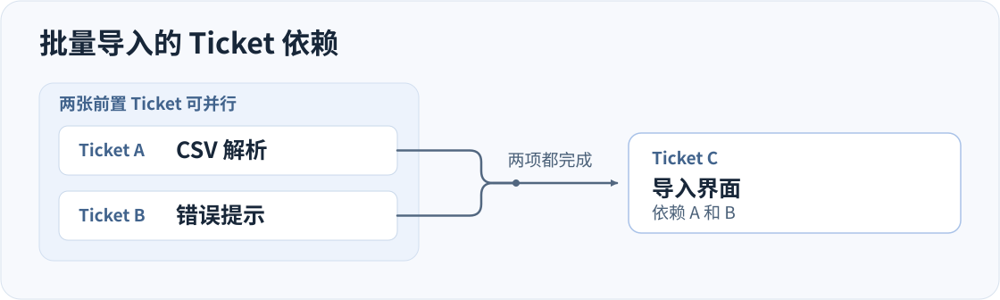
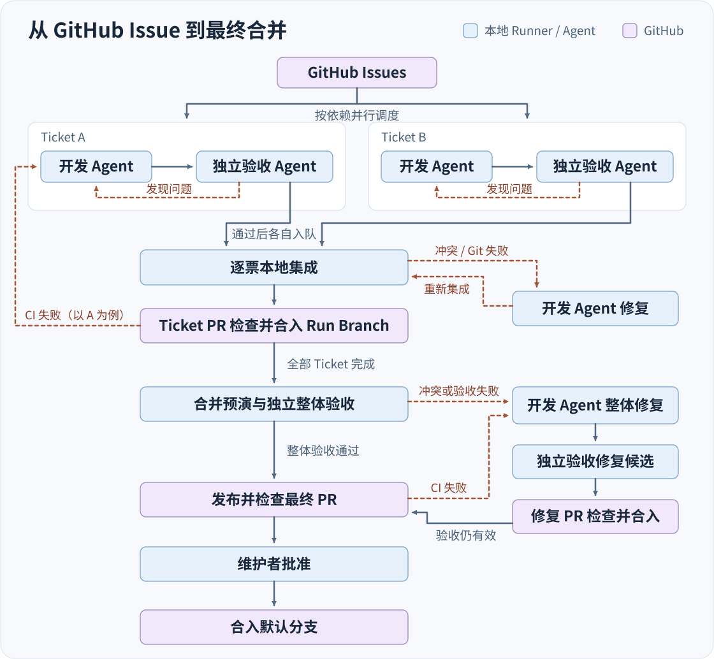
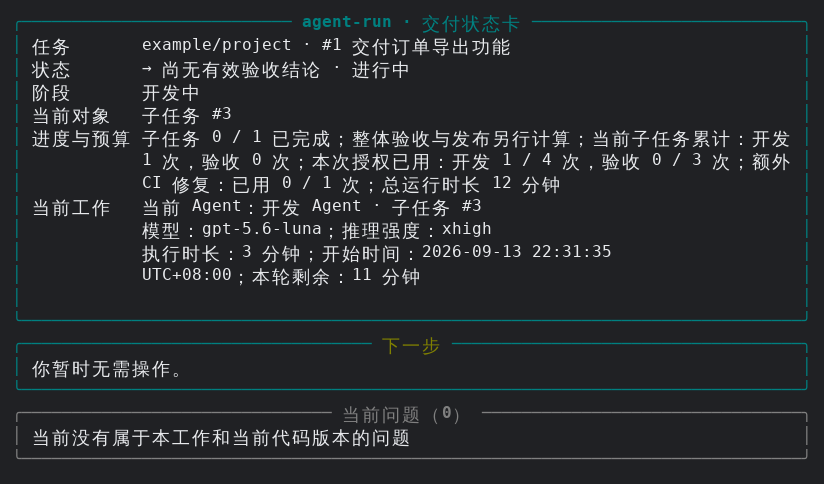
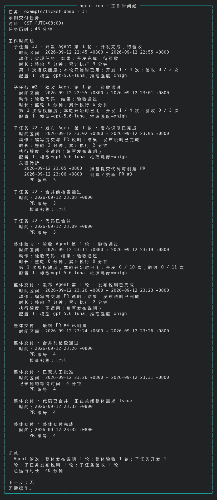
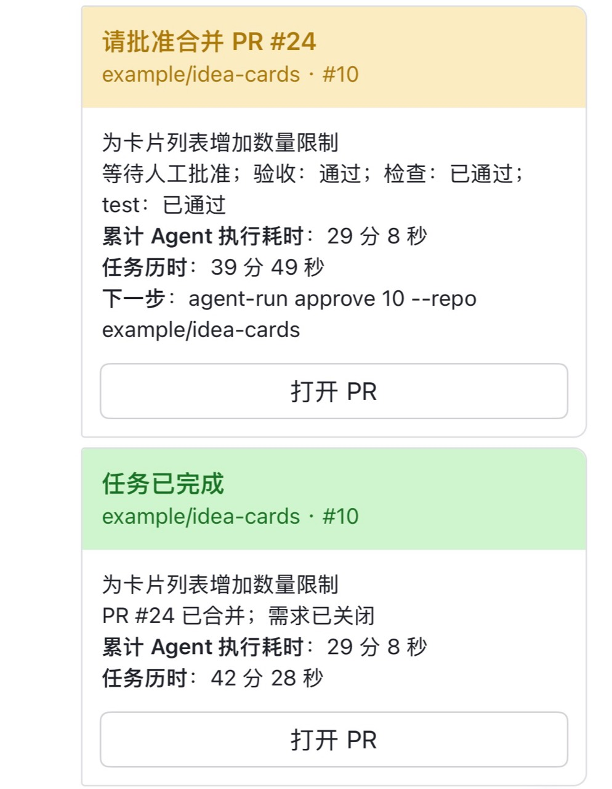
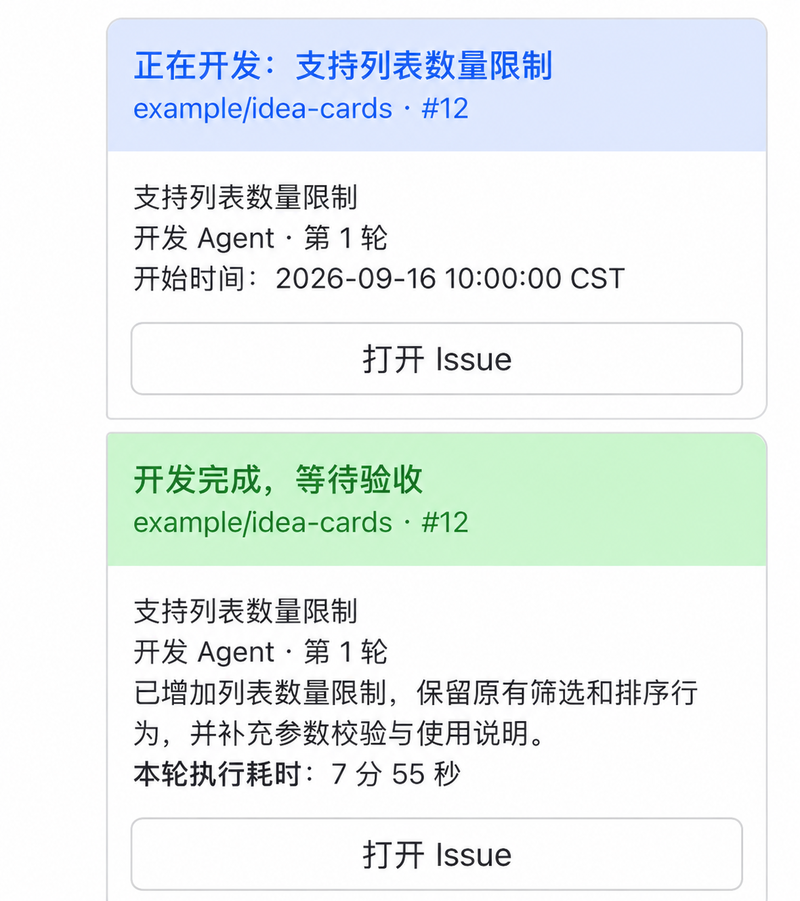
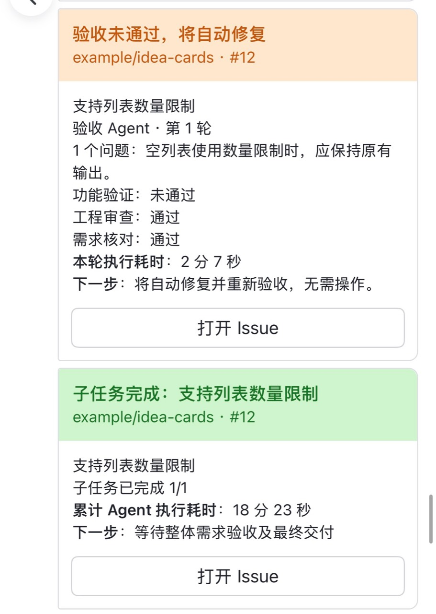
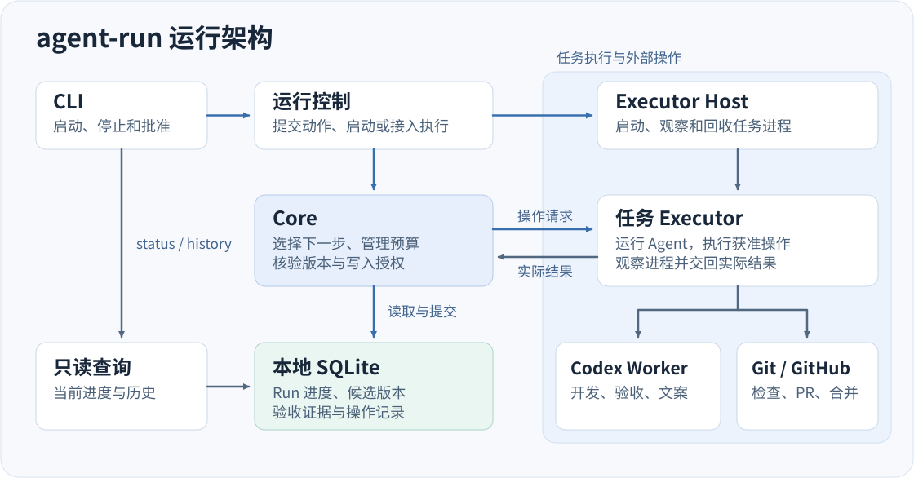

# grill-engineering

[English](README.md) | 简体中文

**用一条命令，把 GitHub 任务推进到可以审阅和批准的 PR。**

可以先用 `grill-me` 或 `grill-with-docs` 把需求讨论清楚，再用 `to-spec` 和 `to-tickets` 把确认的规格和子任务放到 GitHub。 [Matt Pocock Skills](https://github.com/mattpocock/skills)

`agent-run` 接手准备好的 GitHub Issue，调度 Codex 开发和独立验收。子任务按依赖并行推进，集成后再对照原需求验收整个功能。程序跟进合并前检查，最后由你批准合入默认分支。

[安装和使用](#安装和使用) · [交付流程](#交付流程) · [运行截图](#运行截图) · [飞书通知](#飞书通知) · [当前架构](#当前架构)

## 安装和使用

按 [Agent 操作指南](docs/agent-guide.md)完成安装、认证和目标仓库接入。准备好总任务（Parent Issue）后，可以从任意目录启动。这里以编号 `123` 为例。

```bash
agent-run run 123 --repo OWNER/REPO
```

Runner 独立克隆远端仓库，基于已推送的代码交付。你可以继续在自己的 checkout 里工作，也可以从其他目录查询和控制同一个任务。

<details>
<summary>把安装和首次启动交给你的 Agent</summary>

```text
请阅读 https://github.com/GRD-Chang/grill-engineering/blob/main/docs/agent-guide.md，
帮我安装 agent-run、检查仓库和 GitHub 任务是否就绪，然后启动运行。
目标仓库路径：<本地路径>
总任务（Parent Issue）：<GitHub Issue URL>
需要我补充信息或批准最终 PR 时，告诉我。
```

</details>

运行环境为 Linux、Codex CLI 和 GitHub。前台运行、Windows WSL2 和 Mac 上的 Linux 虚拟机仍待验收，具体状态见[支持矩阵](docs/productization/support.md)。运行使用你的 Codex 账号额度，角色模型、修复轮次和等待时长可在[个人运行配置](docs/user-defaults.md)中调整。

## 交付流程

### 示例中的 Ticket 依赖

假设你要给联系人管理加一个批量导入功能。用户在页面上传一份 CSV，就能一次录入多位联系人。如果文件里有错误，页面要告诉用户哪一行出了什么问题。

这个需求可以拆成图中的三张 Ticket。CSV 解析负责读取每行数据，错误提示负责把问题说明白，这两项可以并行开发。导入界面等两项完成后再把它们接到上传页面上。



### 从就绪 Ticket 到最终合并

`agent-run` 从 GitHub 读取任务与依赖，在本地调度开发和独立验收。就绪 Ticket 可以并行推进，各自在本地集成并通过 GitHub PR 检查后，依次合入本次运行的集成分支（Run Branch）。



验收 Agent 在只读工作区核对需求、代码规范和端到端行为。以联系人导入为例，三张 Ticket 都合入 Run Branch 后，整体验收 Agent 会从导入页面上传两份 CSV。一份数据完整，确认联系人能成功录入。另一份在第 3 行缺少姓名，确认页面会提示「第 3 行缺少姓名」。

等待 CI 时，其他 Ticket 仍可开发和验收。Ticket PR 的必需检查失败后，该 Ticket 的开发 Agent 根据检查结果和可取得的日志修复，按配置验收，再重新排队集成并检查新提交。Parent 的修复候选必须独立验收。 [Ticket CI 修复](docs/adr/0021-ticket-ci-development-loop.md) · [Parent 修复 PR](docs/adr/0031-parent-repair-pr-and-repository-ci.md)

如果需求只用一张 Issue 就能讲清楚，可以直接运行这个总任务，走完整开发、独立验收和最终 PR 的流程。开发和修复有轮次上限，等待检查有时限。需要人工继续时，Runner 保存进度，`status` 提示下一步。 [验收、预算与恢复规则](docs/agent-run.md)

## 运行截图

后台运行时可以关闭发起终端。回来用 `status` 看进度、正在工作的 Agent 和需要处理的事项。用 `history` 查看开发、验收、PR 检查与合并记录。



<details>
<summary>查看一次真实测试任务的 history</summary>



</details>

- **停下再继续。** 用 `stop` 暂停当前 Run，稍后用 `resume` 接续，保留已保存的成果、证据和额度。
- **只处理一张 Ticket。** 用 `stop --ticket` 停止指定子任务，用 `resume --ticket` 在可恢复时继续它。其他独立工作可以继续推进。
- **决定是否合并。** 检查和验收满足条件后，先在 GitHub 审阅最终 PR，再用 `approve` 批准当前版本。

查看[命令的准入条件与恢复规则](docs/agent-run.md#命令边界与状态轮转)。

## 飞书通知

启用后，子任务完成、需要你补充信息或批准最终 PR 时，飞书会发来提示。卡片附有对应 Issue 或 PR 的链接，有记录时也会显示工作摘要和耗时。任务完成后也会通知你。

<p align="center">
  
</p>

<details>
<summary>查看详细模式下的开发和验收通知</summary>

<p align="center">
  
</p>

<p align="center">
  
</p>

</details>

飞书默认关闭，启用后默认使用精简模式。需要跟进每轮开发、验收和修复时，可以切换到详细模式。配置见[飞书通知说明](docs/notifications.md)。

## 当前架构



| 模块 | 负责什么 |
| --- | --- |
| CLI 与运行控制 | 接收 `run`、`stop`、`resume` 和 `approve` 等命令，核对并提交本次动作。 |
| Core | 根据依赖、已保存状态和外部事实决定下一步，管理预算及正式操作的授权。 |
| Executor Host 与 Executor | Host 启动、观察和回收任务进程。Executor 运行 Worker，执行实际的 Git 和 GitHub 操作，将结果交回 Core。 |
| Codex Worker 与 Git / GitHub 适配器 | Worker 分角色开发、验收和准备发布文案。适配器读取远端事实，由程序执行获准的 PR、合并等写入。 |
| SQLite 与只读查询 | 保存 Run 进度、候选版本、验收证据和操作记录，供 `status`、`history` 读取。 |

恢复时，程序核对原执行者是否已退出，优先使用已保存的结果。若 GitHub 写入的响应丢失，程序先查询远端实际结果，再决定是否继续原操作。 [当前运行架构](docs/architecture.md)

## 致谢

本项目借鉴了 [ClawSweeper](https://github.com/openclaw/clawsweeper) 的设计思路，感谢其贡献者的开源分享。

## 许可证

本项目采用 [MIT 许可证](LICENSE)。
