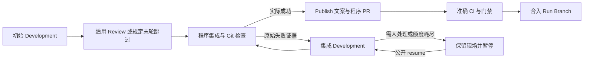

# Ticket 集成失败交回 Development 的有界循环

本决定落实 Ticket 集成切片，取代 ADR 0015 的免费冲突工作和单次处理限制。Parent、CI 与更广暂停续接保留各自现有合同，后续切片再收敛。

程序决定阶段、正式写入及真实结果。初始开发—审核的规定末轮跳过保持真实记录；进入 Ticket 集成后无额外 Review。集成失败在准确现场交给 Development 调查，不通过可修性白名单或 CRLF 专项策略决定修复。Development 只整理文件、验证直接影响并保留双方成果。程序重做检查、提交与集成，成功后经普通 Ticket PR、准确 CI 与既有门禁进入 Run Branch。

`ticket_integration` 编排准确快照，`integration_development` 收敛本路径的请求、调用、线程及结果收口；继续使用共用 Semantic Attempt、Worker 和权限合同，不另建工作流引擎。历史阶段标识 `development / integration_conflict` 表示集成工作，当前请求使用 `repair_source=integration`，不借用 Job 上上一轮 repair source。新线程与人工续接保持局部任务性质。

每 Ticket 的 `integration_development_budget` 默认累计上限 3，政策参数为 `ticket_integration_development_limit`。分配新 Semantic Attempt 后、调用前持久扣一次，pending 续接不重复扣；新失败、源/目标阶段和 resync 共用该累计额度。检查失败关闭已完成的开发语义工作，保留 summary 和失败现场，下一轮携新证据返回 Development。额度耗尽无 pending 工作，公开 resume 仅追加对应授权、保留 used 和续期历史，重复请求不重复续期。独立外部快照 resync 额度继续存在。

Git 失败证据包含 operation、command、returncode、准确 checkout/HEAD/MERGE_HEAD 及 stdout/stderr。持久状态不保存进程 stdout/stderr 字段，使用 `stdout_json` / `stderr_json` 保存 JSON 转义文本，解码恢复包括 CR 的原始输出，同时沿用凭据脱敏。Ticket 并发基线使用实际持久化后的规范文本，避免正常保存被误认作外部竞争。Git 机械动作默认 30 秒截止，失败与超时保留工作；既有身份、追加历史、受管 Git 元数据及正式发布门禁继续有效。

程序集成提交成功、状态保存中断时，恢复认领仍要求准确父提交、预期提交说明和干净工作树，并对记录 HEAD 到当前提交执行 `git diff --check`。提交元数据不能证明实际内容已通过检查；恢复时不使用当前干净索引的空差异代替提交内容。检查失败保留命令与原始证据，通过既有现场失配门禁暂停，不进入发布；合法已提交现场继续原 Semantic Attempt，不重复开发或扣额度。

沿用共享 Ticket Agent 名额、公平队列和单席集成。局部暂停释放席位并保留其他 Ticket 的独立进展；CI 等待不占 Agent 名额。未知外部写入仍保留已有对账门禁。本切片不改 Parent 完整验收、不迁移旧 Run，也不授权 Agent 提交或发布。

依据 [git-diff 官方说明](https://git-scm.com/docs/git-diff) 的 `--check` 非零检查和 [git-merge 官方说明](https://git-scm.com/docs/git-merge) 的冲突现场语义，采用原操作失败交接和 exact-parent 提交核验；不替 Git 决定文件格式或隐藏检查失败。真实 Git/StateStore 和既有 deliver/resume seam 覆盖 CSV BOM/CRLF 检查失败回流、成功提交、独立额度停止与继续；Agent/GitHub 使用可控替身，真实模型保持 opt-in。
