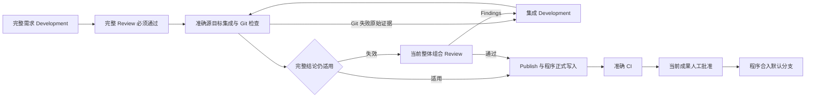

# Parent-only 集成循环与完整验收复用

Parent-only 保留完整初始开发—审核，全部验收维度必须通过。Ticket 末轮跳过与 Ticket CI 配置不授权完整 Parent 发布。沿用共用 Change Delivery、工作调用、Semantic Attempt、准确快照集成、交付锁、追加合并与 Publisher 写入能力。

Git 失败记录实际操作、准确 source/target/candidate/HEAD/MERGE_HEAD、checkout 和原始输出，交给 Development 调查；不增加错误类型白名单或 CRLF 专门修复。Review Findings 同样进入集成 Development，输入包含完整原始验收与准确集成现场。完成后回到真实 Git 检查及适用审核，不另嵌套初始开发审核。新会话与人工续接保持集成任务性质。

每 Parent-only 对象的 `integration_development_budget` 按 frozen `run_repair_rounds` 初始化，默认累计三次实际 Development。Git 修复与集成 Findings 修复共用 used/limit，初始需求、CI 和外部 resync 独立；源目标追加、失败更新和审核不重置用量。新 Semantic Attempt 调用前持久扣一次；同次中断及摘要已返回后的 Git 收口续接不重复扣。额度耗尽保存现场，公开 resume 按本次配置追加对应额度并保留 used、Attempt 和 renewals，重复请求不重复续期；status/history 只读。初始 review_budget 保留原记录，集成审核不消费它；集成后 CI 修复仍按 CI 额度和审核规则执行。

完整验收记录核对 `acceptance_scope=parent_only`、Parent 编号、effective revision、reviewed base、candidate SHA/tree、expected merge tree、Reviewer 身份及全部通过的 Artifact。相同 tree 不能替代身份、版本或基线核对。未变化的准确成果复用；新组合形成当前整体结论。同 Parent、同需求版本的已完成完整 Review 可以提供旧证据和增量比较基线，含 Findings 的旧结果不能授权发布；没有适用基线时建立完整基线。集成 Prompt 展示准确源目标、组合及冲突路径，并要求对整体负责。

文案与正式发布复用既有当前对象门禁及持久结果。确定操作重试复用已保存文案；候选、基线或验收依据变化清除旧发布结果并更新文案。准确 CI 与当前成果的人工批准是最终合并条件，成果改变撤销旧 grant，不能靠 resume 或旧批准放行。非追加历史、身份失配和事实缺失仍保留原门禁；旧 Run 不迁移、不清理其成果。

通过现有 ParentDeliveryEngine deliver/approve 和公开 resume/status/history 验证，保留真实 Git、StateStore 与进程恢复边界。Agent 与 GitHub 使用可控替身；真实模型仍显式 opt-in，不将替身当作模型验收。Git 检查及冲突现场采用 [Git diff](https://git-scm.com/docs/git-diff) 与 [Git merge](https://git-scm.com/docs/git-merge) 的既有语义。
