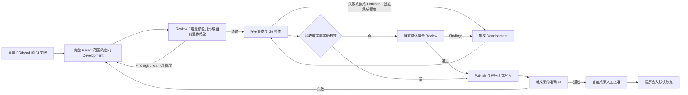

# 两种 Parent 的 CI 定向开发与整体增量验收

[ADR 0025](0025-parent-repair-without-internal-pr.md) 已确认取消完整 Parent 修复的内部 PR，取代本文要求保留该独立交付流程的条款；实施尚未完成。Parent CI 的审核责任、累计额度与最终批准规则保持有效。

Parent-only 与多 Ticket Parent 的准确 Required Checks 失败进入共享 Development–Review 循环。Parent-only 负责完整需求；多 Ticket Parent 负责完整 Run、Ticket Set、真实 Completion 与累计成果，不重开已完成 Ticket。程序提供准确 PR/head、检查 Observation 与可取得的原始日志，不要求失败先被归类为代码可修。pending、unknown 和未匹配当前版本的证据使用有界等待。Development 自主调查失败及直接影响，不能削弱有效检查以制造通过。

Parent Review 始终开启，不继承 `ticket_ci_review`。有同范围、同需求版本的完整验收基线时，Reviewer 使用原始结果与准确比较身份，核验修复及直接回归，并对当前整体成果形成结论；没有适用完整基线时建立完整基线。原 CI 证据在 Findings 修改、新会话和人工 message 中继续提供，不能被最近一轮 Findings 替代。

`parent_ci_development_limit`（CLI `--parent-ci-development-limit`）默认 3，必须为正整数。两种 Parent 与 Ticket 复用同一累计 CI 额度实现；Parent 的 CI Development 和 Review Findings 修改共用一份额度，初始需求、集成、resync 独立。多 Ticket Parent 的内部 Run Repair PR、最终 PR、新提交、新失败 head 和目标追加均不重置用量。状态观察不扣费，同一 Semantic Attempt 的中断续接不重复扣费。已完成但无代码候选的调查仍消耗实际工作额度。

统一状态为 `ci_recovery.window/developments_used`，固定保存在所属交付对象：Parent-only 的 Parent Job 或完整 Parent 的 Run Acceptance；Repair Job 不保存另一份可变 CI 账本，保存重载不重建内存别名。保存失败 head、Semantic Work 身份、Reviewer 原始结果和历史。耗尽形成 `ci_development_budget_exhausted`；公开显式 resume 仅续期耗尽的 CI 窗口并归档用量，重复请求不重复续期，普通继续不清零其他额度。人工求助保留同一工作与原始证据，可通过公开 resume/message 继续。旧内外层预算、首轮例外和可修性分类不再参与编排，旧 Run 不自动迁移。

验收复用核对范围、需求版本、基线、候选 SHA/tree、预期合并结果及适用 Ticket Set/Completion。相同 tree 不能替代全部绑定事实。Publish 只在其成果、基线与验收依据仍有效时复用文案；程序承担提交、推送、PR 与合并。CI 修复改变成果后必须重验准确 CI 并取得新人工批准，旧批准不能放行后继成果。内部 Run Repair 的分支、PR 和交付责任继续保留。

验证使用既有 ParentDeliveryEngine、RunAcceptanceEngine、RunPublicationEngine 和公开 run/resume/approve，结合可控 Agent/GitHub、真实 Git 与 StateStore。覆盖两类 Parent 的失败、修复、当前整体 Review、CI、批准，跨 PR 用量、暂停续期与实际中英文 Prompt；真实模型验证仍显式 opt-in，程序替身不代表模型验收。
