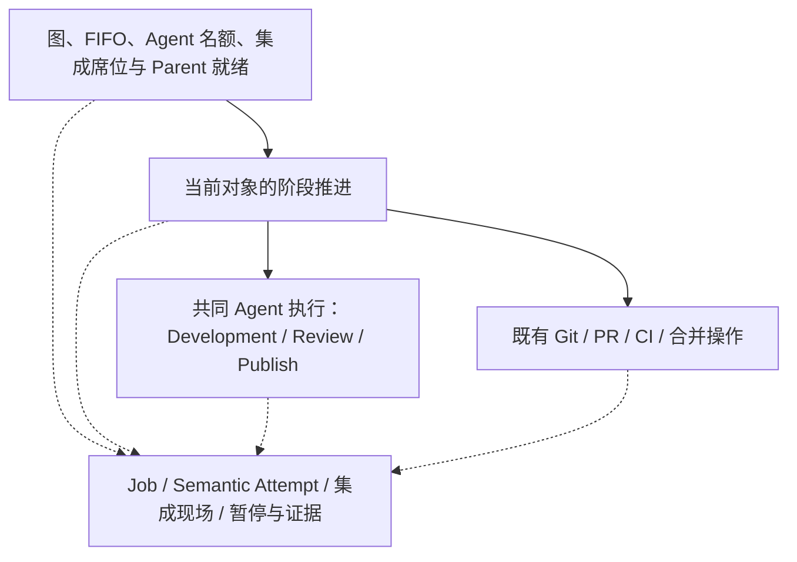
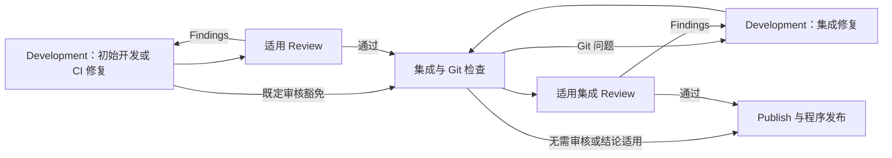
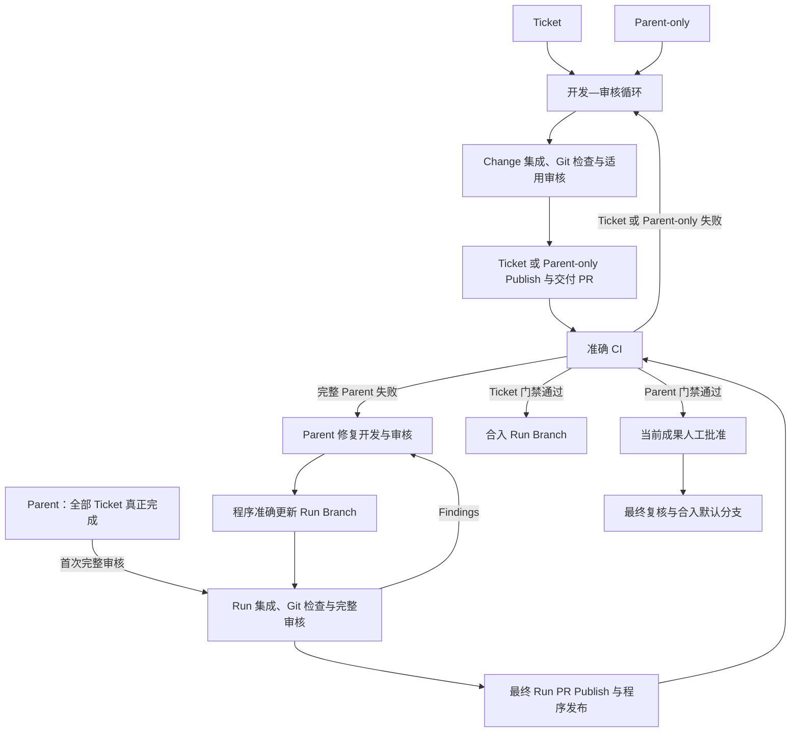

# 分开任务调度、阶段推进与共用执行职责

交付路径已经复用开发—审核等共同循环，但阶段调用方仍重复处理线程、恢复与外部操作协议。目标架构明确三类职责：任务调度选择可推进的工作；阶段推进决定当前交付对象的业务后继；共用执行分别承担 Agent 调用和 Git/GitHub 等确定操作。阶段推进使用执行结果按既定规则继续，Agent 自主完成当前角色工作，不接管跨角色调度。

选择这一职责划分，是为了让业务流程可直接阅读、共同执行规则有明确归属，避免每个对象重新实现调用协议。也不把全部调度、阶段和操作收进一个全能通用引擎；共享能力必须减少调用方所需知识，仅搬动函数或传递大量内部回调不算深化。

业务进度与暂停条件分别记录。每份可独立推进的工作保留准确对象、阶段、当前工作、成果和待完成操作；阶段推进、状态显示和 resume 使用同一份权威事实及其解释。resume 复核现场并处理适用暂停条件后交回正常阶段推进，不通过错误原因另建恢复流程。Agent 已返回而确定操作尚未完成时继续处理原结果，不重复调用 Agent；多 Ticket 分别保留自己的事实和人工门禁。

这一取舍减少暂停前阶段、角色与成果在不同恢复入口之间的重复推导。各 module 维护所属事实，显示摘要只能作为投影；不增加第二套持久工作状态机。

审核结论、CI 观测、Publish 文案和人工批准分别绑定其准确对象及成果事实；阶段引用适用记录，同一类证据的适用规则由共同职责维护。历史记录保留原含义，各类证据不强制采用同一字段集合或统一失效条件；相同 tree 不能替代需求、基线和完整交付事实的核验，Candidate 验收提升仍须证明实际集成结果适用。外部写入结果未知时保留原操作意图并先对账。

预算固定归属于交付对象：Ticket 使用自身额度，完整 Parent（包括 Parent-only）使用自身额度；按既有用途、角色和窗口分别计数。Repair Job 使用所属对象的预算，不搬移或复制可变预算。此合同取代 Run Review Budget 在 Run Acceptance 与 Repair Job 之间移交、归还的持久归属要求，并消除 CI 预算双位置保存后依赖内存别名重绑的实现责任；额度上限、消费时点、累计范围和续期授权不变。固定归属切片已实施：Ticket 与 Parent-only 使用自身 Job，完整 Parent 使用 Run Acceptance 中的 Review Budget、历史与 CI Recovery；Repair Job 不保存这些可变字段。Repair 的集成 resync 额度也保存在 Run 的 `repair_integration_budgets`，按修复代次保持既有窗口隔离；不能与主线 source/target 窗口合并。归属在创建、暂停、重载与修复完成后保持不变，显式 resume 仅续期适用耗尽额度并保留历史。新状态使用 `review_budget_protocol=2`，旧状态拒绝兼容读取，不自动迁移或删除成果。

Review Context 的准备与返回结论绑定由共同职责处理。上下文区分需求范围、完整交付范围和本轮重点变化，提供准确提交、适用前次结论与 Findings、CI 或集成证据；完整 Parent 还保留实际预期合并结果、Ticket Graph 与 Completion。程序固定真实事实，Reviewer 自主决定审查深度及扩大范围，不由程序解析 Findings 并生成具体检查计划。此职责集中复用既有身份与证据，不增加另一套审核状态。实现将调用前的 Review Context 保存于既有 Semantic Attempt，按原身份形成 Acceptance Record，随有界历史保留；完整范围和重点变化独立表达。恢复使用同一快照并附加原始 Human Blocker Artifact 与本次人工回复，既有 currentness 负责否决不适用结论。

本轮集中已有错误处理、Agent 修复、程序等待/对账、暂停与恢复规则，并修正已确认的执行不一致；不扩大 Agent 自动调查范围，不新增普通提交、部分 Parent fetch 或发布操作失败后的 Development 调查流程。相关权限、材料或外部条件问题继续通过现有暂停与人工 resume 处理。这项范围限制使共同机制的深化与新增修复能力分别验收。

共同 Agent 执行、固定预算归属、Review Context 与准确发布对账已接入；完整 Parent 修复由程序更新 Run Branch，不保留内部 Repair PR 生命周期。不要求新增同名文件、进程或第三方框架；除上述预算持久归属调整外，Ticket、Parent、Parent-only 的入口、审核责任、预算策略、最终批准和恢复合同继续有效。内部 Repair PR 的取消另由 [ADR 0025](0025-parent-repair-without-internal-pr.md) 明确授权；其他合并、删除或改变产品策略的事项，须在需求阶段逐项明确，不能由本职责调整隐式授权。

## 共同 Agent 执行的实现边界

`agent_execution.py` 集中开发会话轮换、角色续接模式、Invocation 与现有 Semantic Attempt 的关联、角色调用及返回持久化。阶段只提供当前业务输入、准确 Attempt/边界与 currentness 核验；业务额度、角色交付物消费、Git/PR 操作及后继选择仍归阶段。Change 的普通开发、CI 与集成 Development、Review/Publish，以及完整 Run 的集成 Development、Review/Publish 均经过此边界；Run Repair 仍使用 Change 角色的会话规则。

返回保存在 pending Attempt 的 `returned_result`，经角色 schema 校验后先保存，再交回阶段。成功返回可在阶段结果保存、提交或发布前中断后重载消费；currentness 失效仍走原失效路径，不以缓存放行漂移现场。Human Blocker 与 blocked Review 返回先保存，明确人工继续时清除这份阻塞返回，以同一 Attempt 接收后续答复。完成 Attempt 不归档该缓存，避免长期重复保存 Artifact。status/resume 从同一事实区分已返回的程序收口与仍需 Agent 答复的工作，不新增持久工作状态机。

这一实现参考 [Temporal Tasks 的结果重放边界](https://docs.temporal.io/tasks)：已经记录的非确定执行结果在恢复时直接消费。这里只使用既有 StateStore 和 Semantic Attempt 保存单次返回，不引入 Temporal、事件溯源或通用事务框架；现有 Backend 的格式修复、有界调用恢复与执行所有权保持。

## 任务调度与交付阶段的实现边界

图刷新通过 `graph.schedule_from_graph` 选择有依赖授权的 Ticket，并证明 Parent 是否就绪；它不读取 Parent 的审核、发布或 CI 阶段。公开 `state_from_graph` 组合图调度事实与 `run_orchestration.parent_stage_state` 的阶段投影。Parent-only 直接开发，多 Ticket Parent 必须等每张 Ticket 的真实完成记录成立后进入整体集成与首次完整审核；Issue 关闭或 Ticket PR 合并本身不代替完成记录。

`ChangeDeliveryEngine.advance` 决定当前 Change 的允许后继，复用 `development_review` 和已有集成推进；完整 Parent 继续由 `RunAcceptanceEngine`、Run 集成及发布引擎承担整体责任。集成 Git/Review 修复留在集成循环，CI 修复回当前对象开发循环。Ticket 集成不新增 Review，初始末轮豁免与 CI 可选审核保持，两种 Parent 保留完整审核与最终人工批准。

`AgentWorkScope` 只管理当前阶段的 Agent 许可与执行控制令牌，不选择角色或后继。许可在新工作分配及扣费前取得；已有 `returned_result` 通过共同执行校验与恢复，不重新申请 Agent lease。角色返回后的机械收口立即释放许可，阶段退出也负责异常清理。`ticket_scheduling` 消费 `work_facts.ticket_program_ready`，在名额占满时仍派发已有结果和 Candidate 提交的收口；其后新 Agent 工作仍按同一持久 FIFO 竞争。程序流水线上限继续为两倍 Agent 名额加一个监督线程，不增加资源政策。

正常集成、发布、CI 等待及合入继续使用单席；CI 等待不占 Agent 名额，CI 修复释放席位后重新排队。未知写入保留原意图及必要席位，先读回实际结果；机械可推进不意味着绕过暂停、currentness、准确 PR/CI 或人工批准。status/history/resume 仍读取同一份 Job、Attempt 和集成现场，机械就绪事实不另行持久化，也不生成新恢复状态机。

职责边界参考 [Temporal Task Queues](https://docs.temporal.io/task-queue) 中工作队列与 Worker 容量分开的做法；本项目继续使用现有 StateStore、持久 FIFO 与 Engine，不引入该平台，也不采用其多分区排序政策。

上图省略共同暂停出口及批准失效后的回流。完整 Parent 的修复按 ADR 0025 直接更新 Run Branch，由最终 Run PR 承担 CI 与人工批准；图调度与 Agent 许可分界不恢复内部 Repair PR 生命周期。
