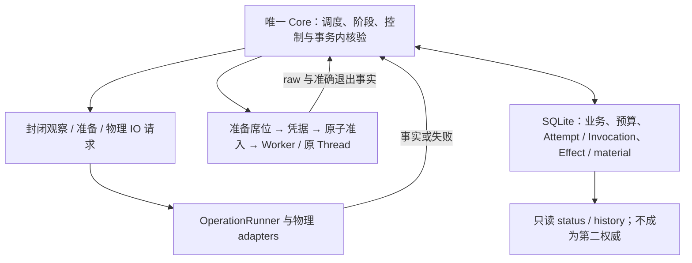

# 分开任务调度、阶段推进与共用执行职责

本决定承接 [#399](https://github.com/GRD-Chang/grill-engineer/issues/399) 与
[#419](https://github.com/GRD-Chang/grill-engineer/issues/419)：代码确定任务与业务后继，
Agent 自主完成当前开发、审核或发布文案工作。调度、业务推进、物理执行是不同职责；
不新增通用工作流引擎、第四个管理 Agent 或第二套持久状态机。
以下映射更新为当前单 Core / repository v23 实现，不要求恢复历史 Engine API 或旧数据。

后续已确认的 [ADR 0031](0031-parent-repair-pr-and-repository-ci.md) 恢复完整 Parent 的修复 PR，
并将仓库 CI 去重与通用 Runner 分开。当前实现复用同一 Core、Parent subject 与 Effect 对账，
在独立候选验收后通过修复 PR 的目标检查和普通合入更新 Run Branch，不恢复旧 Engine 或另一套预算。

## 当前实现与事实归属

| 职责 | 当前权威与调用边界 |
| --- | --- |
| 选择当前工作、容量/FIFO、集成席位 | [Kernel](../../src/agent_run/core/kernel.py) 的 `_operation_choice` / `next_work`；`operation_state` 是只读投影，不分配工作。 |
| 业务推进和控制 | 同一 Kernel 的 `_consume` / `_mechanical` / `_apply_effect` / `control`，在 Storage 事务中重核原对象、Generation、当前性及授权；物理 Runner 不选择其他 subject 或业务后继。 |
| 有界读写协调 | [OperationRunner](../../src/agent_run/core/operation_runner.py) 执行 Core 返回的封闭 IO 请求并交回 `accept_work` / `fail_work`；[operation_contract](../../src/agent_run/core/operation_contract.py) 保存读取身份、ReadFence、工作请求及物理端口合同。它们不是第二调度器。 |
| Agent 准备和实际执行 | `AgentPreparation` 预留同一 Attempt 的席位；[codex](../../src/agent_run/runtime/codex.py) 准备所选凭据，再由 `Kernel.admit_agent` 原子创建 Invocation/output/lease；[execution](../../src/agent_run/runtime/execution.py) 绑定真实进程、最终 Go、退出和 raw。 |
| 原 Thread、输出与恢复 | [attempt_continuation](../../src/agent_run/core/attempt_continuation.py) 从原 Opening、Invocation/output 和前驱链派生恢复事实；格式修复、ordinary/capacity 与有界 semantic 续接各保留自己的期限/计数合同，不因统一入口混合权限。 |
| 正式 Git/GitHub 写入 | Core 固定原 Effect intent，local/remote adapter 执行并读回物理事实；[WriteAuthority](../../src/agent_run/contracts/write_authority.py) 将慢 prepare 与最终无 I/O Core admission 分开，物理事实不自行授权。 |
| 保存与查询 | [Storage](../../src/agent_run/storage/sqlite.py) 保存权威关系；[queries](../../src/agent_run/queries/run.py) 由同源事实形成 status/history，显示摘要不作为恢复依据。 |

## 保留的业务合同

Ticket、Parent-only 从开发进入；多 Ticket Parent 在全部真实 Completion 成立后进入
集成与首次完整 Parent 审核，不重新开发已完成 Ticket。Issue 关闭或 PR 合并本身不代替
Completion。集成 Git 问题和集成 Findings 调用集成 Development 后返回集成检查；
当前 PR/head 的 CI 失败回当前交付对象的开发工作。Ticket 集成不新增 Review，
其初始末轮豁免、CI 可选审核保持；两种 Parent 保留完整验收责任与最终人工批准。
完整 Parent 修复经候选验收、修复 PR 检查及普通合入进入 Run Branch，再推进最终 PR，
其取舍见 [ADR 0031](0031-parent-repair-pr-and-repository-ci.md)；[ADR 0025](0025-parent-repair-without-internal-pr.md) 保留旧路径的历史决定。

业务进度和暂停分别保存：`subjects.phase/purpose/generation/current_attempt` 表达当前工作，
`gates`、Run 级 stopped/blocked 表达阻止条件。`attempts.result_id` 关联已保存角色产物，
`invocation_outputs.raw_id` 关联物理 raw；两者不能合成一个“已经完成”标志。
已返回的结果继续由原阶段消费，不能因重载或换 Thread 重复调用 Agent。
resume 处理适用暂停后回到同一推进路径；message 不接受新需求/图，不替代批准，
不解除其他 Ticket 的独立人工门禁。未知写入保留原 intent/serial，先读回再消费，不能盲重放。

预算权威是 `budgets(subject,purpose,window)`，按对象、用途和窗口隔离；
`resync_allowances` / `integration_snapshots` 保留各自的代次与 source/target 窗口。
CI 中的 Review Findings 修改仍使用 CI 预算；修复原因不等于计费归属。
准备席位在既有 `waits` 内，与真实 lease 共用容量；凭据未就绪不创建 Invocation。
Development 在最终 Worker 放行或实际返回工作证据处以 `attempts.accounted` 仅计一次；
分配、bootstrap 绑定、状态读取不是收费或退出证明。显式 resume 只续期适用耗尽窗口，
不清零历史或无关用量。此处描述 v21 现行计费，不追认旧版本行为。

Review Context 在调用前保存于原 Semantic Attempt 的上下文，按 #441/#443/#444
固定本轮唯一比较范围：首次开发从开发起点、Findings 复审从紧邻实际审核提交、
首次 CI 从失败 head、首次集成从目标快照，均到实际审核提交。
当前开发说明、原始 Findings、CI/集成证据及 Parent 的 Graph/Completion/预期合并结果
保持准确绑定；完整需求与成果历史是背景，不形成第二个 full/focus 范围。
Review、CI、文案与批准各按自己的对象事实核验，tree 相同不足以复用全部授权。
Reviewer 自主选择核验深度，程序不解析自然语言 Findings 制定修复计划。

## 退休实现与边界

历史 `agent_execution.py`、`work_facts.py`、`run_orchestration`、
`ChangeDeliveryEngine`、`RunAcceptanceEngine`、`AgentWorkScope` 与
`ticket_scheduling` 不再是当前运行入口，不应按旧文件名恢复它们。
Job/Repair Job 的预算搬移、`repair_integration_budgets`、
`review_budget_protocol=2` 和 `returned_result` 也不是当前字段或协议。
当前采用 v21 的上述关系与 `material` 外键，不双写镜像或兼容旧 Run；
[preflight](../../src/agent_run/storage/preflight.py) 明确拒绝旧协议并保留旧现场。
具体期限和恢复规则见[状态存储](../agents/state-storage.md)与实际合同，
本次映射更新不调整额度、调度策略、自动调查范围或低层安全边界。

此图表示现行实现归属，不合并 Attempt、Invocation、外部 Effect 或资源生命周期。
完整交付、故障恢复及平台能力各按自己的真实验收记账，架构文档本身不是通过证明。
