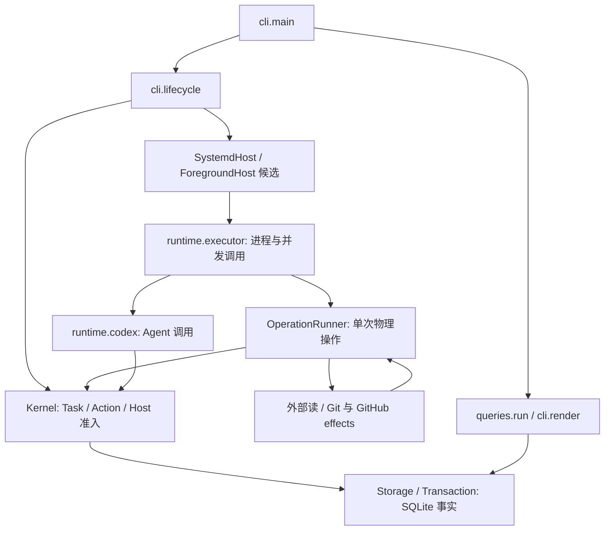

# 当前运行架构

本页是现行源码架构概览。正式运行只有一个 `agent_run` 包和一个 Core 编排入口。
实现职责以本页及链接源码为准；ADR、带日期的研究与 handoff 保留其决策和验证时点，
其中旧模块名、协议及实验入口不代表当前支持。

## 正式入口与工作流

安装后的 `agent-run` 与 `python -m agent_run` 共同进入
[`cli.main.main`](../src/agent_run/cli/main.py)。
生命周期命令由 [`cli.lifecycle`](../src/agent_run/cli/lifecycle.py) 注册，查询、个人设置和 Run Profile 分别分流，
不通过合成场景启动用户任务。操作步骤见[安装指南](install.md)和[Agent 指南](agent-guide.md)。

Ticket、Parent-only 和完整 Parent 的 Final 交付共用一个 Core。
开发、独立审核、修复、集成、CI、发布及批准按各自交付对象推进；
完整 Parent 的修复直接更新 Run Branch，仅最终 Run PR 承担最终发布和人工批准。
本页的架构归属说明不改变业务流程、角色合同或批准条件。
从准备 Parent 到一条命令推进、人工批准和收尾的操作路径见
[运行说明](agent-run.md#一条命令推进-ticket-交付)。

前后台合同及前台尚未完成的验收见[运行模式](agent-run.md#运行模式与前台候选验收)。

## 模块责任

| 模块 | 负责什么 | 不承担什么 |
| --- | --- | --- |
| [`Kernel`](../src/agent_run/core/kernel.py) | 从当前 SQL 事实决定状态迁移、currentness、预算、工作 FIFO、集成单席、控制准入及写入授权 | 不把 Git/GitHub、Agent 调用或等待放进业务写事务 |
| [`Storage / Transaction`](../src/agent_run/storage/sqlite.py) | 事务、关系事实、材料摘要与拥有者核验、有界读取和容量检查 | 不选择后继工作，不重建另一套可变 Run 引擎 |
| [`OperationRunner`](../src/agent_run/core/operation_runner.py) | 获取冻结配置，协调一次观察、Core 请求、实际操作和结果对账 | 不自行制定业务后继、预算或写权限 |
| [`executor`](../src/agent_run/runtime/executor.py) | Agent 与 I/O 的物理并发、取消、等待和返回/退出收口 | 不用 Future 完成代替持久租约释放或退出证明 |
| [`runtime.handoff`](../src/agent_run/runtime/handoff.py)、[`SystemdHost`](../src/agent_run/adapters/systemd.py) | 环境交接、Runner 使用租约、systemd 启动与原 Host 身份观察 | 不把未知启动或未知退出当成重新启动许可 |
| [`ForegroundHost`](../src/agent_run/runtime/foreground_host.py)、[`adapters.foreground`](../src/agent_run/adapters/foreground.py) | 显式前台候选的 namespace 启动、握手、原进程身份和退出观察；正常收尾仍待验收 | 不替代 Core 或后台 Host，不把跨 observer 的未知退出当作恢复许可 |
| [`adapters.source`](../src/agent_run/adapters/source.py)、[`RemoteEffects`](../src/agent_run/adapters/remote.py)、[`LocalEffects`](../src/agent_run/adapters/local_git.py)、[`LocalGit`](../src/agent_run/adapters/git_objects.py) | 真实需求、refs、PR/checks 读取，Git/GitHub 操作、资源检查和准确读回 | 不用读取失败推断不存在，不自行重试未知写入 |
| [`runtime.codex`](../src/agent_run/runtime/codex.py)、[`core.prompts.role`](../src/agent_run/core/prompts/role.py) | 已分配调用的 Prompt、隔离进程、Thread、原始返回及活动事实 | 不从 Agent 自报完成推导业务通过或合并许可 |
| [`queries.run`](../src/agent_run/queries/run.py)、[`cli.render`](../src/agent_run/cli/render.py)、[`queries.execution`](../src/agent_run/queries/execution.py) | 同源只读状态、分页历史、冻结设置和显示 | 不恢复执行、不写业务状态、不发送通知 |
| [`cli.settings`](../src/agent_run/cli/settings.py)、[`config.creation`](../src/agent_run/config/creation.py)、[`cli.profiles`](../src/agent_run/cli/profiles.py) | 个人默认、创建时固定输入和显式 Run Profile 操作 | 不以最新个人默认补造既有 Run 的原配置 |

单一 `agent_run` 包按 core、contracts、config、storage、adapters、runtime、queries、notifications、cli、install 划分职责，承载业务核与正式链路使用的叶模块。
它们由正式链路使用，不能因包名仍在就解释成另一套交付编排。
通知由 [`NativeNotifications`](../src/agent_run/notifications/sender.py) 观察已提交事实，
使用独立 outbox/transport；查询展示与实际投递分别负责。

Core 通过 [`operation_contract`](../src/agent_run/core/operation_contract.py) 给出完整读取和操作请求；
OperationRunner 以冻结的 `OperationBinding` 组合真实端口，将观察和结果交回 Core，自己不读取 SQL。
`run_once` 返回 AgentPreparation 后由 Executor 准备凭据；Core 原子准入返回 AgentCall 后才派发 Agent，不在 I/O 驱动中等待模型或 CI 完成。
公开 status/history 只读数据库，不调用这条会接受新观察的运行链路。

Core 在消费观察事实的同一事务内核对 ReadFence 和原读取期限。
Requirements 在有序写入准入后先核对期限，再接受来源变化；Delivery 事实在同一只读快照内核对并组装。
只读消费发现过期时正常关闭读事务，由新有序写事务重新核对并保存超时，再返回等待结果；
原观察期限不因等待保存而延长，消费逻辑只执行一次。这里不缓存跨事务权限，后续实际写入仍独立授权。

## 状态与证据

本开发候选的唯一状态协议是 **`independent-delivery-repository-v22`**；
尚待同版独立验收，不表示已经部署或验证真实 Host。
每个受管仓库使用 `repositories/<owner>/<repo>/state/kernel.sqlite3`。
Task 可先独立持久化为 idle；完整冻结的 Run、必要关系/材料及 `Task.current_run`
在同一短事务中提交。该数据库是唯一发布与发现权威，不再发布或读取 JSON locator。
具体事务和读取范围见[状态存储](agents/state-storage.md)，显示归属见[展示事实](agents/display-facts.md)。

旧 JSON/v6、native v17–v21、来源封印、导入状态和未激活的仓库实验协议明确拒绝，
不升级、不转换、不兼容推进。
[`storage.preflight`](../src/agent_run/storage/preflight.py) 在读取、写前及写锁内核验唯一协议和完整schema；
[`storage.tasks`](../src/agent_run/storage/tasks.py) 保留原 Task mutex inode 与撤权FD，
旧JSON位置记录只能阻止新的执行准入，内容不再选择或授权Run。
这些拒绝检查不提供迁移入口，也不授权删除旧数据库、Candidate、材料或工作区。

原始 Agent 返回落盘与业务消费分别提交。Attempt、Invocation、物理输出、Thread 绑定、
预算窗口、effects intent/receipt 和历史证据保留准确归属；恢复优先消费已存返回。
每次真实外部写入前仍经过 Core 的当下授权检查，未知结果沿同一 intent 读回，
数据库提交、展示状态和 Agent 报告均不能代替真实外部结果或进程退出证据。

Git 子进程由调用方独占回收，宿主在调用期间须保持默认 SIGCHLD 且无竞争收割者。
每次启动前验证当前信号策略与 pidfd/waitid 能力：已知 glibc Linux x86_64 LP64 ABI
直接读取 sigaction，并以 self pidfd 的 ECHILD 验证系统调用；其他 ABI 保留真实短子进程探针。
仅缓存 ABI 绑定，不缓存策略或授权。该检查依赖正常 Linux errno 语义，不支持伪造系统调用结果的宿主。
实际 Git 仍使用 pidfd、WNOWAIT 与准确进程组清理；写授权在准备之后、启动之前重新核验。

故障 Host 在 Worker drain 前先封闭原执行代次的准入；无法持久撤销时将已持有的 Task 锁留至进程退出，
不在业务事务中等待物理清理。guardian 创建者负责事务外 wait/reap；其他观察者只用匹配的 pidfd 证明准确退出，
后台继续核验 Host/cgroup/FD-store；前台候选核验原 observer、namespace 和准确进程退出。原启动期限不续期，3秒仅为回收宽限，未知退出不等于可重新准入。

Required Checks 按当前 head、required context/App 和完整 rollup/latest 证据核验，未知不当作通过。
PR 原 base 快照与实时 target ref 分开保存语义；祖先关系须绑定准确身份，CLOSED 还须核验原退休 receipt。
这不改变 Review/批准/写入授权，也不承诺远端原子 base-CAS；运行前提见[安装与仓库接入](install.md)。

## 测试支撑与配置归属

合成 GitHub、脚本 Agent 和独立 Git world 位于 `tests/support`：
`offline.py` 组织场景，`offline_api.py` 提供原始合成 API 记录，
`offline_git.py` 管理私有 bare Git world。入口和用途见
[合成外部 world 指南](../tests/support/README-offline.md)。
这些支撑替换物理 I/O，调用生产 Kernel/OperationRunner/RemoteEffects，
不另算业务后继、预算或授权；它们不是产品的 offline 用户入口。

个人设置统一使用 `settings show/configure`；`UserDefaultsStore` 只读取当前
`user-defaults.json`，旧 `delivery-policy.json` 不读取、导入、改写或删除。
旧 `policy` 命令、旧快照 parser 与显示分支已退出。
创建与显式窗口续期经配置层调用
[`resolve_delivery_policy`](../src/agent_run/contracts/policy_values.py)，
归一化当前配置并返回唯一的 [`model.Policy`](../src/agent_run/model.py)；
这个解析叶不是已退休的第二套策略模型。Run 冻结值、明确覆盖与后继窗口的归属保持原合同。

正式 Agent 调用由 `runtime.executor` / `runtime.codex` 执行 Core 分配的工作，
保存准确 Thread、返回和退出证据；测试脚本 Agent 仍属于测试支撑。

以上是源码状态区分，不是运行验收结论；历史通过数不自动成为当前提交的全量验证结果。
